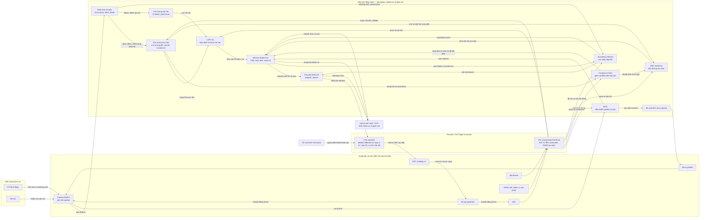

# KẾ HOẠCH TRÌNH BÀY DỰ ÁN TRƯỚC BAN GIÁM ĐỐC

## Hệ thống quadrotor bám mục tiêu và hạ cánh chính xác trên H-Pad

> **Thời lượng:** 7 phút · **Số slide:** 15 · **Đối tượng:** Ban Giám đốc và lãnh đạo kỹ thuật<br>
> **Thông điệp:** Dự án đã có pipeline điều khiển tích hợp trong PX4 SITL/Gazebo; kết quả hiện tại là kết quả mô phỏng. Tích hợp phần cứng và bay thực là bước tiếp theo cần kiểm chứng.

## Kết quả đối chiếu với dự án hiện tại

Đề cương cũ nắm đúng các hướng kỹ thuật chính—ArUco đa tỉ lệ, EKF mục tiêu, I-APF, Covariance Gate, SMC, FSM và touchdown—nhưng nhiều tuyên bố được viết như kết quả đã xác nhận dù repo không có bằng chứng phù hợp. Nội dung dưới đây đã được điều chỉnh theo mã nguồn và hiện vật trong repo.

| Nội dung cần chỉnh | Điều đối chiếu được trong repo | Cách thể hiện trong slide mới |
|---|---|---|
| Bãi đáp “nested/đồng tâm”, ID 42 52.5 cm và ID 43 10 cm | Board config đặt marker lớn lệch khỏi marker nhỏ trên cùng mặt phẳng, dùng chung hệ tọa độ. Kích thước ID 43 còn lệch giữa [board config](../vision/dual_scale_board_config.yaml) (10 cm) và [mission params](../simulation/config/mission_params.yaml) (5 cm). | Gọi là board hai tỉ lệ, chung hệ tọa độ; bỏ số đo cho đến khi xác nhận board in và đồng bộ cấu hình. Không gọi là marker đồng tâm/lồng nhau. |
| “FSM 7 pha” | FSM có 5 pha cấp cao: IDLE, SEARCH, FOLLOW, APPROACH, LAND. Reacquire và các pha SMC là trạng thái/nhánh con, không phải 7 pha FSM. | Vẽ đúng 5 pha và nhánh mất dấu, hủy lệnh, wave-off. |
| Ngưỡng cố định 2σ, phễu 30°, công thức vận tốc hạ và các ngưỡng touchdown | Gate tính bất định tương đối, so với vùng cho phép theo hình học, độ mới phép đo và trạng thái phát hiện. SMC có luật reaching; hạ cuối dùng điều khiển căn giữa và vận tốc hạ theo pha. ROS touchdown node hiện dùng odometry, độ cao quang học, lệnh hạ và bộ chốt thời gian; logic lõi còn có tùy chọn PX4-landed/impact nhưng node chưa nối các tín hiệu đó. | Chỉ trình bày khối, I/O và công thức thuật toán; bỏ các trị số cấu hình khỏi slide kiến trúc. |
| Simulink đã kiểm chứng, bay ngoài trời, bench-test Pi 5, 30 Hz, PX4 250 Hz, C++20 triển khai xong | Repo có module Python, kết quả mô phỏng/benchmark và các header C++ mẫu. Không thấy mô hình `.slx`/`.mdl`, gói C++ ROS 2 có thể build, hay báo cáo bay đóng vòng trên Pi/Pixhawk. `hardware/main_aruco_detector.py` là entry point vision độc lập, không phải pipeline landing hai marker đã tích hợp. | Ghi rõ phần nào là mô phỏng, phần nào là kế hoạch. Không khẳng định đã bay phần cứng hoặc đạt thông số xử lý trên companion computer. |
| Khóa mục tiêu 0.77 s, yaw <2.5°, né vật cản >0.85 m, sai số hạ cánh ~1 cm, 100% không nảy | `docs/tracking_follow_status.md` ghi các kết quả của một lượt SITL trước đó; các báo cáo batch trong `simulation_results/` cho kết quả khác nhau. Batch 10 lượt ghi nhận 8/10 thành công; batch 3 lượt ghi 3/3 nhưng sai số trung bình 8.61 cm và tối đa 11.87 cm. Benchmark I-APF ngoại tuyến ghi nhận 7/10 lượt không va chạm. | Dùng số liệu có tên báo cáo, cỡ mẫu và nhãn mô phỏng; không gộp kết quả giữa các batch hoặc nói “100%/đảm bảo tuyệt đối”. |
| “Triệt tiêu 100% GPS”, “không điểm mù”, “chống lật tuyệt đối”, tuyên bố thị trường | Đây là tuyên bố tuyệt đối hoặc so sánh thị trường chưa có dữ liệu chứng minh trong repo. | Đổi thành lợi ích/kỳ vọng kỹ thuật có giới hạn và phân biệt rõ mục tiêu với kết quả đã đo. |

**Lưu ý trước khi chốt slide:** cần xác nhận kích thước marker nhỏ đang in dùng thực tế và đồng bộ `vision/dual_scale_board_config.yaml`, `simulation/config/mission_params.yaml` cùng cấu hình detector. Không đưa kích thước hay tầm nhận diện lên slide cho đến khi đối chiếu xong.

## Phân bổ 7 phút

| Phần | Slide | Thời lượng |
|---|---:|---:|
| Bài toán và phạm vi | 1–3 | 75 giây |
| Đóng góp và kiến trúc hệ thống | 4–6 | 90 giây |
| Kiến trúc module và công thức | 7–10 | 120 giây |
| Kết quả hiện có và mức sẵn sàng | 11–13 | 95 giây |
| Giá trị, bước tiếp theo và đề nghị | 14–15 | 40 giây |
| **Tổng** | **15 slide** | **420 giây** |

# Nội dung đề xuất từng slide

## Phần 1 — Bài toán và phạm vi

### Slide 1 — Hệ thống quadrotor bám mục tiêu và hạ cánh chính xác

**Thời lượng:** 15 giây<br>
**Visual:** Ảnh Gazebo/RViz của pipeline đang chạy; nếu dùng ảnh phần cứng thì ghi rõ đó là phần cứng tham chiếu, không phải bằng chứng bay thực.

**Nội dung:** Tên dự án, nhóm thực hiện, ba từ khóa: thị giác ArUco đa tỉ lệ, dẫn đường tránh vật cản, hạ cánh có giám sát an toàn.

**Lời thoại:** “Nhóm xin trình bày hệ thống quadrotor nhận biết bãi đáp H-Pad, bám mục tiêu, tránh vật cản và thực hiện quy trình hạ cánh có kiểm soát. Kết quả tích hợp hiện có được đánh giá trong môi trường PX4 SITL và Gazebo.”

### Slide 2 — Bài toán cần giải quyết

**Thời lượng:** 30 giây<br>
**Visual:** Ba thách thức: duy trì nhận biết mục tiêu ở các cự ly khác nhau; dẫn đường trong môi trường có chướng ngại; chỉ hạ khi trạng thái và chất lượng ước lượng đủ tin cậy.

**Nội dung:** Mục tiêu của dự án là kết hợp nhận thức, bám đuổi, tránh vật cản và hạ cánh chính xác trong một pipeline. Tách rõ **mục tiêu thiết kế** với **kịch bản đã kiểm chứng**: các thuật toán tracking có kịch bản mục tiêu chuyển động, trong khi world SITL tích hợp hiện đặt H-Pad tại vị trí cố định.

**Lời thoại:** “Bài toán không chỉ là nhìn thấy marker. Drone cần quy đổi phép đo về cùng hệ tọa độ, điều khiển bám mục tiêu, phản ứng với vật cản và kiểm tra độ tin cậy trước khi hạ. Kịch bản bãi đáp di động là hướng thiết kế; kết quả SITL tích hợp hiện tại chưa chứng minh hạ cánh lên bãi đáp chuyển động.”

### Slide 3 — Rủi ro khi giải từng phần riêng lẻ

**Thời lượng:** 30 giây<br>
**Visual:** Bốn thẻ “mất dấu”, “kẹt đường đi”, “ước lượng chưa chắc chắn”, “xác nhận tiếp đất sai” nối tới các khối tương ứng trong hệ thống.

**Nội dung:**

1. Một marker đơn lẻ có thể không phù hợp xuyên suốt các cự ly camera khác nhau.
2. APF cơ bản có thể gặp cực tiểu địa phương hoặc bị đẩy khỏi đích gần vật cản.
3. Điều khiển landing chỉ theo khoảng cách không phản ánh độ bất định và độ mới của phép đo.
4. Chỉ dựa vào độ cao hoặc một tín hiệu đơn lẻ có thể xác nhận touchdown không đúng lúc.

Không gắn các số liệu GPS/barometer hay khẳng định đây là giới hạn của toàn bộ giải pháp thị trường nếu chưa có nguồn đo hoặc trích dẫn.

**Lời thoại:** “Các rủi ro này xuất hiện ở giao điểm giữa thị giác, dẫn đường và điều khiển. Dự án xử lý chúng bằng một pipeline tích hợp và các cổng kiểm tra trước khi chuyển pha.”

## Phần 2 — Đóng góp và kiến trúc tổng quan

### Slide 4 — Các đóng góp kỹ thuật của dự án

**Thời lượng:** 45 giây<br>
**Visual:** Năm khối nối tiếp, mỗi khối một động từ: nhận biết, ước lượng, dẫn đường, kiểm tra, thực thi.

1. **Board ArUco hai tỉ lệ:** hai marker trên cùng board phẳng, quy về cùng hệ tọa độ của bãi đáp.
2. **Target EKF:** làm mượt vị trí mục tiêu và ước lượng vận tốc để cung cấp trạng thái cho bộ điều khiển.
3. **I-APF 3D:** kết hợp lực hút, lực đẩy và hướng tiếp tuyến để hỗ trợ thoát kẹt.
4. **Covariance Gate + SMC:** đưa độ bất định vào quyết định cho phép tiếp cận và dẫn đường hạ cánh.
5. **FSM + touchdown + Offboard:** điều phối nhiệm vụ, xác nhận tiếp đất từ nhiều nguồn trạng thái và gửi lệnh tới PX4.

**Lời thoại:** “Giá trị chính nằm ở việc các khối phối hợp thành chu trình có phản hồi: nhận biết và ước lượng mục tiêu, tính hướng di chuyển, kiểm tra điều kiện an toàn, rồi mới phát setpoint xuống bộ điều khiển bay.”

### Slide 5 — Kiến trúc tổng quan hệ thống

**Thời lượng:** 25 giây<br>
**Visual:** Sơ đồ khối từ trái sang phải, có vòng phản hồi odometry và camera.

**Các khối và luồng dữ liệu:**

- **Cảm biến/môi trường:** ảnh RGB-D từ Gazebo trong pipeline SITL; PX4 cung cấp odometry và trạng thái phương tiện.
- **Nhận thức:** ArUco detector xuất pose, bounding box và cờ phát hiện; EKF adapter đổi hệ tọa độ và xuất trạng thái mục tiêu cùng covariance.
- **Dẫn đường/giám sát:** I-APF nhận trạng thái drone, đích và vật cản; IBVS nhận bounding box; Covariance Gate và SMC nhận trạng thái mục tiêu, odometry và covariance.
- **Điều phối/chấp hành:** Mission FSM chọn setpoint theo pha; Offboard Commander gửi lệnh vận tốc/yaw và xử lý disarm tới PX4.
- **Phản hồi:** PX4/Gazebo trả odometry, trạng thái bay và ảnh về các khối phía trên.

**Lời thoại:** “Đây là pipeline phần mềm đang được tích hợp trong ROS 2 với PX4 SITL và Gazebo. FSM là khối điều phối trung tâm; các bộ perception và control phát dữ liệu/lệnh qua giao diện ROS 2.”

### Slide 6 — FSM nhiệm vụ và nhánh an toàn

**Thời lượng:** 20 giây<br>
**Visual:** State diagram năm pha:

```text
IDLE → SEARCH → FOLLOW → APPROACH → LAND → IDLE
          ↑         │          │        │
          └─ mất dấu┘          ├─ hủy/mất tracking → FOLLOW
                               └─ wave-off/mất điều kiện ở LAND → APPROACH
```

SEARCH/FOLLOW có logic bắt lại mục tiêu; SMC báo các sub-phase dẫn đường/hạ cuối nhưng không phải các pha cấp cao riêng của FSM. Touchdown đã xác nhận kết thúc nhiệm vụ; mất tracking hoặc mục tiêu lệch trong LAND có thể đưa FSM về APPROACH để căn chỉnh/bắt lại.

**Lời thoại:** “FSM hiện có năm pha chính. Hạ cánh là một quy trình có điều kiện; nếu mất tracking hoặc mục tiêu dịch khỏi vùng phù hợp trong pha cuối, hệ thống quay về tiếp cận thay vì coi nhiệm vụ đã hoàn thành.”

## Phần 3 — Kiến trúc module và công thức chính

> Các slide 5–10 trình bày **khối chức năng, input/output và công thức thuật toán**. Không đưa kích thước marker, tốc độ, tần số, ngưỡng hay hệ số cấu hình lên các slide kiến trúc. Nếu hội đồng hỏi sâu, mở file cấu hình/mã nguồn làm tài liệu tham chiếu.

### Slide 7 — Nhận thức mục tiêu: ArUco Board và EKF

**Thời lượng:** 30 giây<br>
**Khối kiến trúc:** Ảnh + camera info → phát hiện marker/ước lượng pose board → đổi hệ camera sang world bằng TF → Target EKF.

**Input:** Ảnh, camera intrinsics, pose quan sát, TF/odometry.<br>
**Output:** Pose/bounding box/cờ phát hiện và trạng thái mục tiêu `[x, y, z, vx, vy, vz]` kèm covariance.

**Công thức minh họa:**

```text
(R*, t*) = argmin(R,t) Σk || uk − π(K, R Pk + t) ||²
x(k|k−1) = F x(k−1|k−1)
Kk = P(k|k−1) Hᵀ [H P(k|k−1) Hᵀ + R]⁻¹
d² = νᵀ S⁻¹ ν
```

Trong đó nghiệm pose giảm sai số chiếu lại; EKF dự đoán/cập nhật trạng thái chuyển động và dùng innovation distance để kiểm tra measurement.

**Lời thoại:** “Các marker được ánh xạ về cùng hệ tọa độ của bãi đáp, sau đó EKF kết hợp phép đo mới với trạng thái dự đoán. Những khối sau dùng chung một trạng thái mục tiêu và độ bất định thay vì xử lý từng ảnh độc lập.”

### Slide 8 — Dẫn đường tránh vật cản I-APF 3D

**Thời lượng:** 30 giây<br>
**Khối kiến trúc:** Vị trí drone + vị trí đích + mô tả vật cản → tính lực hút/đẩy → phát hiện cực tiểu địa phương → chọn hướng tiếp tuyến → vận tốc dẫn đường.

**Input:** Odometry, trạng thái mục tiêu/điểm đích, vật cản.<br>
**Output:** Vận tốc hướng dẫn, yaw mục tiêu và thông tin chẩn đoán lực/hướng thoát.

**Công thức minh họa:**

```text
Fatt = 2 katt (g − p)
wrep(dg) = 1 / (1 + exp(−dg)) − 1/2
Ftotal = Fatt + Frep + Ftan
```

Trọng số theo khoảng cách đích điều biến lực đẩy; khi phát hiện trạng thái kẹt, bộ lập kế hoạch đánh giá các hướng tiếp tuyến và chọn hướng theo đích, độ thông thoáng và tính liên tục.

**Lời thoại:** “I-APF giữ cấu trúc lực thế dễ diễn giải, đồng thời thêm thành phần tiếp tuyến và chọn hướng dựa trên vật cản. Đây là bộ tạo vận tốc dẫn đường; FSM vẫn là nơi tổng hợp lệnh cuối.”

### Slide 9 — Covariance Gate: giám sát an toàn landing

**Thời lượng:** 30 giây<br>
**Khối kiến trúc:** Covariance mục tiêu + covariance drone/attitude + hình học tương đối + trạng thái detection → đánh giá vùng sai số và độ mới measurement → quyết định an toàn.

**Input:** Target state/covariance, odometry/covariance, vị trí tương đối, cờ và tuổi phép đo.<br>
**Output:** `safe_to_land`, bán kính bất định, bán kính chuyển pha thích ứng và trọng số cho SMC.

**Công thức minh họa:**

```text
Prel = Ptarget + diag((h σatt)², (h σatt)², σz²)   [marker-relative]
R2σ = 2 √λmax(Prel,xy)
safe = fresh ∧ detected ∧ in_range ∧ (R2σ ≤ Rallow(Δz))
```

Trong chế độ marker-relative, thành phần sai số ngang được dựng từ covariance mục tiêu và bất định attitude theo hình học thay vì cộng trực tiếp sai số tọa độ toàn cục. Vùng cho phép phụ thuộc hình học bãi đáp/độ cao; không mô tả gate như một ngưỡng cố định duy nhất.

**Lời thoại:** “Gate kiểm tra đồng thời chất lượng ước lượng và hình học tương đối. Kết quả của gate điều kiện hóa quyết định chuyển pha và giúp SMC thích nghi theo độ bất định.”

### Slide 10 — Servo thị giác, SMC và xác nhận touchdown

**Thời lượng:** 30 giây<br>
**Ba khối:**

- **IBVS:** bounding box, odometry và tracking state → lệnh góc gimbal/yaw. Sai số ảnh `eimg = [u−u0, v−v0]ᵀ` được xử lý theo điều khiển tỉ lệ có giới hạn tốc độ/làm mượt; khi tracking cũ, không tiếp tục đuổi pixel stale.
- **SMC:** vị trí/vận tốc drone, trạng thái mục tiêu, độ bất định/gate → lệnh vận tốc ENU và sub-phase. Pha glide dùng mặt trượt theo range, góc dốc và azimuth cùng luật reaching:

  ```text
  S = [Srange, Selevation, Sazimuth]ᵀ
  Ṡi = −ki |Si|^(n/m) sign(Si)
  ```

- **Touchdown:** altitude/velocity, lệnh hạ và khoảng cách quang học → xác nhận sau khi trạng thái dừng phù hợp với tiếp xúc và được duy trì đủ lâu; khi camera không có phép đo mới, node dùng ngưỡng altitude dự phòng. Tín hiệu đi tới FSM/Offboard để kết thúc và disarm. Dạng rút gọn: `touchdown = persist(kinematic_stop ∧ optical_near)`.

**Lời thoại:** “IBVS giữ đường ngắm, SMC tạo vận tốc tiếp cận rồi chuyển sang căn giữa/hạ cuối. Bộ touchdown kiểm tra trạng thái bay và tín hiệu liên quan trước khi phát sự kiện kết thúc; các công thức được trình bày ở dạng thuật toán, không phải bộ tham số tinh chỉnh.”

## Phần 4 — Kết quả hiện có và mức sẵn sàng

### Slide 11 — Benchmark thuật toán ngoại tuyến

**Thời lượng:** 30 giây<br>
**Visual:** Ba ô kết quả kèm nhãn rõ “mô phỏng/benchmark phần mềm”, không dùng ảnh hoặc ngôn từ gợi ý bay thật.

- **Target EKF:** báo cáo trên năm quỹ đạo tổng hợp ghi filtered position RMSE khoảng 0.080–0.109 m. Nguồn: `simulation_results/target_state_ekf/metrics.json`.
- **I-APF tracking:** benchmark 10 kịch bản chuyển động/vật cản ghi 7/10 lượt collision-free (70%). Đây là kết quả hiện có và cũng là hạng mục cần cải thiện. Nguồn: `simulation_results/module_benchmarks/guidance_benchmark_report.json`.
- **IBVS:** benchmark tổng hợp 10 lượt ghi mean yaw error 0.57° và settling time trung bình 0.56 s. Đây không phải phép đo phần cứng. Nguồn: `simulation_results/module_benchmarks/ibvs_benchmark_report.json`.

**Lời thoại:** “Các benchmark phần mềm cho thấy một số khối đã có số liệu định lượng, đồng thời chỉ ra I-APF còn các kịch bản va chạm cần xử lý. Đây là kết quả mô phỏng module, chưa thay thế kiểm chứng tích hợp và bay thực.”

### Slide 12 — Kết quả tích hợp PX4 SITL và Gazebo

**Thời lượng:** 35 giây<br>
**Visual:** Ảnh chụp Gazebo/RViz kèm bảng kết quả của một batch được nêu tên.

| Báo cáo mô phỏng | Kết quả trong artifact | Cách diễn giải |
|---|---|---|
| `full_system_10runs_evaluation` | 8/10 lượt thành công theo evaluator (80%); sai số landing ngang trung bình 20.4 cm, p95 77.4 cm | Batch 10 lượt; chưa đạt cơ sở để tuyên bố độ tin cậy ổn định. |
| `official_batch_evaluation` | 3/3 lượt thành công theo evaluator; sai số landing ngang trung bình 8.61 cm, tối đa 11.87 cm | Batch riêng, cỡ mẫu nhỏ; không gộp với batch 10 lượt. |

**Ghi chú dưới slide:** “PX4 SITL + Gazebo; không phải bay phần cứng. Hai báo cáo khác nhau về batch/KPI, cần chuẩn hóa phiên bản code, cấu hình và tiêu chí thành công trước khi chốt KPI nghiệm thu.”

**Lời thoại:** “Pipeline đã được chạy tích hợp với PX4 SITL và Gazebo. Kết quả hiện có chưa đồng nhất giữa các batch: báo cáo 10 lượt đạt 8/10, còn batch 3 lượt đạt 3/3 với sai số trung bình 8.61 cm. Nhóm cần chuẩn hóa phép đo và tăng số lượt trước khi kết luận KPI.”

### Slide 13 — Mức sẵn sàng phần cứng và khoảng trống triển khai

**Thời lượng:** 30 giây<br>
**Visual:** Ba cột: “đã có trong repo”, “chưa có bằng chứng”, “bước triển khai”.

- **Đã có:** vision RealSense độc lập, mã ROS 2/Python cho pipeline SITL, tài liệu bàn giao và các header C++ tham khảo.
- **Chưa xác nhận:** board và kích thước marker thống nhất; pipeline vision đa tỉ lệ nối với companion/PX4; build/chạy C++ trên thiết bị nhúng; bench closed-loop; bay có dây hoặc bay thực.
- **Bước tiếp theo:** đồng bộ board/cấu hình → tích hợp camera, companion và PX4 trên bàn → kiểm tra an toàn không cánh/quay cánh có kiểm soát → bay thử bãi tĩnh trong vùng an toàn.

**Lời thoại:** “Repo đã có phần mềm mô phỏng và tài liệu chuyển giao, nhưng chưa có bằng chứng đủ để gọi là đã hoàn tất bench-test Raspberry Pi/Pixhawk hay bay thực. Đây là ranh giới cần nêu rõ khi báo cáo trạng thái dự án.”

## Phần 5 — Giá trị và đề xuất

### Slide 14 — Giá trị ứng dụng tiềm năng

**Thời lượng:** 20 giây<br>
**Visual:** Ba tình huống định hướng: quay về trạm sạc, tiếp cận bãi đáp trên phương tiện, hạ cánh trong khu vực có vật cản.

**Nội dung:** Nền tảng có thể hướng tới tự động quay về/đáp vào pad, kiểm tra công nghiệp hoặc tiếp vận. Ghi đây là **tiềm năng ứng dụng**; chưa tuyên bố đã triển khai thương mại hay xác nhận hiệu năng trong môi trường thực địa.

**Lời thoại:** “Nếu hoàn tất tích hợp phần cứng và kiểm chứng an toàn, kiến trúc này có thể mở rộng cho trạm sạc, kiểm tra công nghiệp và các bãi đáp trên phương tiện. Giai đoạn hiện tại tập trung chứng minh độ tin cậy trước khi mở rộng ứng dụng.”

### Slide 15 — Lộ trình đề xuất và đề nghị Ban Giám đốc

**Thời lượng:** 20 giây<br>
**Visual:** Roadmap theo cổng kiểm chứng, không ghi mốc tháng/quý khi chưa có kế hoạch được phê duyệt.

1. **Cổng 1 — Chuẩn hóa mô phỏng:** thống nhất board/config, KPI và evaluator; chạy lại batch SITL đủ lớn, lưu log và kết quả có thể truy xuất.
2. **Cổng 2 — Tích hợp phần cứng:** camera + companion computer + PX4; kiểm tra theo quy trình an toàn trước khi bay.
3. **Cổng 3 — Thử nghiệm bay:** bắt đầu với pad tĩnh và vùng bay kiểm soát; chỉ chuyển sang pad chuyển động sau khi đạt tiêu chí an toàn đã duyệt.

**Đề nghị:** phê duyệt nguồn lực và điều kiện để hoàn tất Cổng 1–2; thống nhất tiêu chí nghiệm thu trước khi lên kế hoạch bay thực.

**Lời thoại:** “Nhóm đề nghị Ban Giám đốc cho phép chuẩn hóa kết quả mô phỏng và triển khai giai đoạn tích hợp phần cứng theo các cổng an toàn. Sau khi có dữ liệu bench và tiêu chí đạt được thống nhất, nhóm sẽ trình kế hoạch bay thử cụ thể.”

## Mermaid kiến trúc điều khiển thực tế cho draw.io

Sơ đồ này mô tả **các vòng điều khiển của cấu hình quadrotor triển khai thực tế**: camera và cảm biến → máy tính đồng hành → Pixhawk/PX4 → ESC, động cơ và drone → phản hồi cảm biến. Đây là kiến trúc mục tiêu để thiết kế slide, không phải xác nhận rằng toàn bộ phần cứng đã được tích hợp và bay kiểm chứng. Trong draw.io, chọn **Arrange → Insert → Mermaid** (hoặc **Insert → Advanced → Mermaid**, tùy phiên bản) rồi dán mã.


