# 📐 KIẾN TRÚC HỆ THỐNG CHI TIẾT (SYSTEM ARCHITECTURE SPECIFICATION)
## DỰ ÁN: VDT QUADROTOR AUTONOMOUS TRACKING, OBSTACLE AVOIDANCE & PRECISION LANDING

> **Mục tiêu**: Bản vẽ thiết kế và mô tả chi tiết toàn bộ kiến trúc phần cứng vật lý, kiến trúc phần mềm phân tầng ROS 2, luồng dữ liệu thời gian thực (Dataflow) và cơ chế chuyển giao trạng thái an toàn (FSM).

---

## 1. SƠ ĐỒ KHỐI ĐIỀU KHIỂN HỆ THỐNG (CONTROL SYSTEM BLOCK DIAGRAM - SLIDE PHÊ DUYỆT)

Sơ đồ khối dưới đây được xây dựng chuẩn mực theo cấu trúc điều khiển tự động kinh điển (Leader - Follower / Quadrotor Control Architecture), ánh xạ chuẩn xác 100% các biến và đường dây tín hiệu vào/ra từ mã nguồn thực tế của dự án VDT Quadrotor:

```mermaid
flowchart LR
    %% ========================================================
    %% KHỐI 1: QUỸ ĐẠO BÃI ĐÁP / LEADER (PHÍA TRÊN)
    %% ========================================================
    subgraph LEADER_SYS ["QUỸ ĐẠO MỤC TIÊU / BÃI ĐÁP DI ĐỘNG (LEADER)"]
        direction LR
        P_REF["Quỹ đạo đặt<br/><b>r_ref(t)</b>"] -->|"r_ref"| CTRL_L["Bộ điều khiển<br/>bám bãi đáp"]
        CTRL_L --> LEADER["Leader / Bãi đáp H-Pad<br/>(Nested ArUco ID 42+43)"]
    end

    %% Tín hiệu từ Leader xuống Follower
    LEADER -->|"p_L (x_T, y_T, z_T)<br/>v_L (v_xT, v_yT, v_zT)"| GUIDANCE
    LEADER -->|"ψ_L (Góc hướng)"| GUIDANCE

    %% ========================================================
    %% KHUNG NÉT ĐỨT ĐỎ: HỆ THỐNG ĐIỀU KHIỂN QUADROTOR (FOLLOWER)
    %% ========================================================
    subgraph FOLLOWER_SYS ["HỆ THỐNG ĐIỀU KHIỂN & ĐỘNG LỰC HỌC QUADROTOR (FOLLOWER)"]
        direction LR

        %% 1. BỘ ĐIỀU KHIỂN DẪN ĐƯỜNG (OUTER LOOP)
        GUIDANCE["<b>Bộ điều khiển dẫn đường<br/>& Tránh vật cản 3D</b><br/>(I-APF / SMC 45° / IBVS)"]

        %% 2. KHỐI TRUNG GIAN CHUYỂN ĐỔI GÓC NGHIÊNG
        subgraph CONV ["Khối chuyển đổi<br/>góc nghiêng"]
            direction TB
            PHI_D["ϕ_d (Roll)"]
            THETA_D["θ_d (Pitch)"]
        end

        %% 3. BỘ ĐIỀU KHIỂN GÓC TRẠNG THÁI (INNER LOOP)
        ATTITUDE["<b>Bộ điều khiển<br/>góc trạng thái</b><br/>(PX4 Attitude Controller 250Hz)"]

        %% 4. ĐỘNG LỰC HỌC ĐỘNG CƠ & MIXER
        MOTORS["<b>Động lực học<br/>động cơ & Mixer</b><br/>(ESC & Actuator Allocation)"]

        %% 5. ĐỘNG LỰC HỌC QUADROTOR 6-DOF
        DYNAMICS["<b>Động lực học<br/>Quadrotor 6-DOF</b><br/>(UAV Rigid-Body Dynamics)"]

        %% 6. BỘ ƯỚC LƯỢNG TRẠNG THÁI & GIÁM SÁT AN TOÀN (PHÍA DƯỚI)
        ESTIMATOR["<b>Ước lượng trạng thái & Giám sát an toàn</b><br/>(PX4 EKF2 + Covariance Gate + Touchdown)"]

        %% LIÊN KẾT NỘI BỘ VÒNG ĐIỀU KHIỂN XUÔI:
        %% u_z -> u_1 đi THẲNG vào Động cơ (bỏ qua Attitude Controller)
        GUIDANCE -->|"u_z (Lệnh vận tốc đứng v_z_cmd) ➔ u_1 (Lực nâng Thrust T)"| MOTORS

        %% u_x, u_y đi vào Khối chuyển đổi góc nghiêng
        GUIDANCE -->|"u_x (v_x_cmd)<br/>u_y (v_y_cmd)"| CONV
        CONV -->|"ϕ_d, θ_d"| ATTITUDE

        %% ψ_d đi thẳng vào Bộ điều khiển góc trạng thái
        GUIDANCE -->|"ψ_d (Góc Yaw mong muốn từ IBVS / Motion)"| ATTITUDE

        %% Đầu ra Bộ điều khiển góc trạng thái u_2, u_3, u_4
        ATTITUDE -->|"u_2 (τ_x Roll)<br/>u_3 (τ_y Pitch)<br/>u_4 (τ_z Yaw)"| MOTORS

        %% Động cơ xuất tốc độ vòng quay [Ω]
        MOTORS -->|"[Ω] = [Ω_1, Ω_2, Ω_3, Ω_4]ᵀ"| DYNAMICS

        %% LIÊN KẾT PHẢN HỒI (FEEDBACK LOOPS):
        %% Phản hồi góc tư thế ϕ, θ, ψ về Attitude & Estimator
        DYNAMICS -->|"ϕ, θ, ψ (Góc tư thế thực tế)"| ATTITUDE
        DYNAMICS -->|"ϕ, θ, ψ"| ESTIMATOR

        %% Phản hồi vị trí & vận tốc p_F, v_F về Guidance & Estimator
        DYNAMICS -->|"p_F (x, y, z), v_F (v_x, v_y, v_z)"| GUIDANCE
        DYNAMICS -->|"p_F, v_F"| ESTIMATOR

        %% Ước lượng & Giám sát an toàn xuất tín hiệu:
        %% - Cờ safe_to_land và R_switch thích ứng cho Guidance
        ESTIMATOR -->|"ζ_xyz (Cờ safe_to_land, R_switch, Bù trôi)"| GUIDANCE
        %% - Tín hiệu Force Disarm ngắt trực tiếp động cơ khi chạm sàn
        ESTIMATOR -.->|"Lệnh ngắt khẩn cấp Force Disarm (param2=21196.0)"| MOTORS
        %% Styling
        style FOLLOWER_SYS stroke:#ef4444,stroke-width:3px,stroke-dasharray: 6 6,fill:#fff1f2,fill-opacity:0.2
        style LEADER_SYS stroke:#3b82f6,stroke-width:2px,fill:#eff6ff,fill-opacity:0.3
        style CONV fill:#fef3c7,stroke:#f59e0b,stroke-width:1.5px
    end
```



### BẢNG ĐỐI CHIẾU & QUY CHUẨN ĐƯỜNG DÂY TÍN HIỆU (SIGNAL INTERFACE SPECIFICATION)

| Đường dây tín hiệu | Ký hiệu Toán học | Ánh xạ Code trong Dự án (ROS 2 / PX4) | Khối Phát | Khối Nhận | Ý nghĩa vật lý & Chức năng điều khiển |
|---|---|---|---|---|---|
| **Trạng thái Leader / Mục tiêu** | $\mathbf{p}_L, \mathbf{v}_L, \psi_L$ | `/ekf/target_state` (`PoseWithCovariance`, `Twist`) | `Leader / Target EKF` | `Bộ điều khiển dẫn đường ngoài` | Tọa độ 3D $[\hat{x}_T, \hat{y}_T, \hat{z}_T]$, vận tốc $[\hat{v}_{xT}, \hat{v}_{yT}, \hat{v}_{zT}]$ và góc hướng của bãi đáp H-Pad |
| **Kênh độ cao (Cao độ)** | $u_z \longrightarrow u_1$ | `vel_cmd.linear.z` $\to$ PX4 Thrust Setpoint $T$ | `Bộ điều khiển dẫn đường ngoài` | `Động lực học động cơ & Mixer` | **Đi thẳng sang Động cơ (bỏ qua Attitude Controller)**: Sinh ra tổng lực nâng $u_1 = c_T \sum \Omega_i^2$ để giữ/thay đổi độ cao |
| **Kênh mặt phẳng ngang** | $u_x, u_y$ | `vel_cmd.linear.x`, `vel_cmd.linear.y` (ENU) | `Bộ điều khiển dẫn đường ngoài` | `Khối chuyển đổi góc nghiêng` | Vector vận tốc ngang mong muốn từ I-APF (tránh cản) hoặc SMC (dốc trượt 45°) |
| **Góc Roll mong muốn** | $\phi_d$ | PX4 `vehicle_attitude_setpoint.roll_body` | `Khối chuyển đổi góc nghiêng` | `Bộ điều khiển góc trạng thái` | $\phi_d = \frac{1}{g}(u_x \sin \psi - u_y \cos \psi)$ — Nghiêng thân để tạo gia tốc ngang theo trục Y |
| **Góc Pitch mong muốn** | $\theta_d$ | PX4 `vehicle_attitude_setpoint.pitch_body` | `Khối chuyển đổi góc nghiêng` | `Bộ điều khiển góc trạng thái` | $\theta_d = \frac{1}{g}(u_x \cos \psi + u_y \sin \psi)$ — Nghiêng thân để tạo gia tốc ngang theo trục X |
| **Góc Yaw mong muốn** | $\psi_d$ | `/mission/yaw_setpoint`, `/ibvs/yaw_cmd` | `Bộ điều khiển dẫn đường ngoài` | `Bộ điều khiển góc trạng thái` | **Đi thẳng vào Attitude Controller**: Lệnh xoay góc mũi drone từ IBVS để camera luôn khóa tâm bãi đáp |
| **Các mô-men xoay thân** | $u_2, u_3, u_4$ | PX4 Torque Setpoints $[\tau_x, \tau_y, \tau_z]$ | `Bộ điều khiển góc trạng thái` | `Động lực học động cơ & Mixer` | $u_2$: Mô-men Roll ($\tau_\phi$); $u_3$: Mô-men Pitch ($\tau_\theta$); $u_4$: Mô-men Yaw ($\tau_\psi$) |
| **Tốc độ góc động cơ** | $[\Omega]$ | PWM ESC / Motor Angular Velocities $[\Omega_1..\Omega_4]^T$ | `Động lực học động cơ & Mixer` | `Động lực học Quadrotor 6-DOF` | Tốc độ quay của 4 động cơ không chổi than sau khi giải ma trận Mixer phân bổ lực |
| **Phản hồi góc tư thế** | $\phi, \theta, \psi$ | `/odom.pose.orientation` (PX4 IMU / EKF2) | `Động lực học Quadrotor 6-DOF` | `Bộ điều khiển góc trạng thái` & `Estimator` | Khép vòng kín ổn định góc nghiêng (250 Hz) và xoay vector tọa độ thị giác |
| **Phản hồi vị trí & vận tốc** | $\mathbf{p}_F, \mathbf{v}_F$ | `/odom.pose.position`, `/odom.twist.linear` | `Động lực học Quadrotor 6-DOF` | `Bộ điều khiển dẫn đường ngoài` & `Estimator` | Khép vòng kín vị trí ngoài (Position Loop), cấp tọa độ tính lực hút APF và mặt trượt SMC |
| **Giám sát an toàn hạ cánh** | $\mathbf{\zeta}_{xyz}$ | `/landing/safe_to_land`, `/landing/rswitch_adaptive` | `Ước lượng & Giám sát an toàn` | `Bộ điều khiển dẫn đường ngoài` | Cấp cờ chuyển pha $2\sigma \le 0.45\text{m}$, kiểm tra nón $30^\circ$, điều biến bán kính thích ứng dốc trượt |
| **Ngắt động cơ khẩn cấp** | Force Disarm | MAVLink `MAV_CMD_COMPONENT_ARM_DISARM` (`param2=21196.0`)| `Ước lượng & Giám sát an toàn` | `Động lực học động cơ & Mixer` | Can thiệp ngắt ga trực tiếp khi Touchdown Detector chốt tiếp sàn $0.35\text{s}$, triệt tiêu hiện tượng nảy/lật |

---

## 2. KIẾN TRÚC KẾT NỐI VẬT LÝ & PHÂN BỔ TÍNH TOÁN

```
┌────────────────────────────────────────────────────────────────────────────────────────┐
│                                 MÁY TÍNH TRẠM MẶT ĐẤT (HOST GCS)                       │
│  • QGroundControl: Giám sát tọa độ GPS, độ cao, la bàn, Flight Mode                    │
│  • GCS Operator Terminal: Phát lệnh /operator/land_command, Emergency Abort            │
│  • CycloneDDS Unicast: ROS_DOMAIN_ID=42 qua Hotspot Wi-Fi 2.4/5GHz                    │
└───────────────────────────────────────────▲────────────────────────────────────────────┘
                                            │ Wi-Fi Unicast UDP (Peer-to-Peer)
                                            │ ROS 2 DDS Topics
┌───────────────────────────────────────────▼────────────────────────────────────────────┐
│                    COMPANION COMPUTER (RASPBERRY PI 5 / JETSON NANO)                   │
│                                                                                        │
│  ┌────────────────────────┐    USB 3.0     ┌────────────────────────────────────────┐  │
│  │ Intel RealSense D435i  ├───────────────►│ Vision & Estimation Pipeline           │  │
│  │ (RGB-D 640x480 @ 30Hz) │                │ • aruco_detector (PnP Nested Board)    │  │
│  └────────────────────────┘                │ • target_state_ekf (6-state CV Filter) │  │
│                                            └──────────────────┬─────────────────────┘  │
│                                                               │                        │
│                                                               ▼                        │
│  ┌────────────────────────┐   PWM (GPIO)   ┌────────────────────────────────────────┐  │
│  │ Gimbal Servo MG90S     │◄───────────────┤ Guidance, Safety & Planning            │  │
│  │ (Pitch: -85° to 0°)    │                │ • covariance_gate (2σ & 30° Conical)   │  │
│  └────────────────────────┘                │ • smc_guidance (45° Glide Slope)       │  │
│                                            │ • iapf_core (3D Dynamic Tangent APF)   │  │
│                                            │ • ibvs_controller (Nadir Tilt Mode)    │  │
│                                            └──────────────────┬─────────────────────┘  │
│                                                               │                        │
│                                                               ▼                        │
│                                            ┌────────────────────────────────────────┐  │
│                                            │ FSM & Actuation                        │  │
│                                            │ • mission_fsm_node (7-phase Manager)   │  │
│                                            │ • touchdown_detector (0.35s Latch)     │  │
│                                            │ • offboard_commander (ENU -> NED)      │  │
│                                            └──────────────────┬─────────────────────┘  │
└───────────────────────────────────────────────────────────────┼────────────────────────┘
                                                                │ UART TELEM2 (/dev/ttyAMA0)
                                                                │ Baudrate: 921600 8N1
                                                                │ MAVLink Offboard / micro-XRCE-DDS
┌───────────────────────────────────────────────────────────────▼────────────────────────┐
│                       FLIGHT CONTROLLER: PIXHAWK 6C (PX4 AUTOPILOT)                    │
│  • Firmware: PX4 v1.14+                                                                │
│  • PX4 EKF2: Dung hợp IMU (250Hz), Barometer, GPS, Magnetometer                        │
│  • Vòng lặp điều khiển vận tốc & tư thế (Position/Velocity PID Inner Loop: 250Hz)       │
│  • Failsafe Motor Cut: Thực thi MAVLink Force Disarm (param2=21196.0)                   │
│  • Động cơ & ESC: Điều khiển 4 cụm động cơ Brushless Quadrotor                         │
└────────────────────────────────────────────────────────────────────────────────────────┘
```

---

## 3. CHI TIẾT CÁC TẦNG CHỨC NĂNG & THUẬT TOÁN

### 3.1. Tầng 1: Nhận Thức & Ước Lượng Trạng Thái (Perception & Estimation)
* **`aruco_detector` (Dual-Scale PnP Board Solver)**:
  * Nhận luồng ảnh RGB từ RealSense D435i ($640 \times 480 @ 30\text{Hz}$).
  * Giải bài toán PnP đa điểm trên cấu trúc bãi đáp A0 lồng 2 marker:
    * **Marker lớn (ID 42, $52.5\text{cm}$)**: Dùng ở tầm xa ($1.2\text{m} \to 8.0\text{m}$).
    * **Marker nhỏ (ID 43, $10.0\text{cm}$)**: Dùng ở tầm sát đất ($0.05\text{m} \to 1.5\text{m}$).
  * Cả 2 marker được quy chiếu về cùng gốc $(0,0,0)$ tại tâm bãi đáp $\rightarrow$ Tọa độ đo liên tục $C^0$, triệt tiêu hoàn toàn bước nhảy vị trí khi chuyển giao marker.
* **`ekf_ros_adapter` / `target_state_ekf` (Target Estimator)**:
  * Bộ lọc Kalman mở rộng 6 trạng thái trong hệ World: $\mathbf{x} = [x, y, z, v_x, v_y, v_z]^T$.
  * Tích hợp cổng khoảng cách Mahalanobis ($d_M^2 \le 16.27$) loại bỏ $100\%$ nhiễu ngoại lai.
  * Khi mục tiêu bị che khuất ($<3.0\text{s}$), chuyển sang chế độ **Dead Reckoning** dự đoán quán tính, giúp hệ thống không bị mất bám.

---

### 3.2. Tầng 2: Giám Sát An Toàn & Dẫn Đường (Guidance & Safety)
* **`covariance_gate` (Dual-Covariance Fusion & Safety Monitor)**:
  * Dung hợp ma trận hiệp phương sai ước lượng bãi đáp ($P_{target}$) và sai số vị trí drone ($P_{drone}$):
    $$\mathbf{P}_{relative} = \mathbf{P}_{target} + \mathbf{P}_{drone}$$
  * Phân rã trị riêng tìm phương rủi ro lớn nhất trên mặt phẳng ngang:
    $$\lambda_{max}(\mathbf{P}_{xy}) \implies \text{Bán kính không định } 2\sigma = 2\sqrt{\lambda_{max}}$$
  * **Điều kiện an toàn hạ cánh**: $2\sigma \le 0.45\text{m}$ VÀ góc lệch nằm trong phễu nón $\theta_{cone} \le 30^\circ$.
  * Tự động điều biến bán kính chuyển mạch dốc trượt thích ứng: $R_{switch} \in [4.5\text{m}, 10.0\text{m}]$.
* **`smc_guidance` (45° Glide Slope Precision Landing)**:
  * Bộ điều khiển trượt 3D (Sliding Mode Control) dẫn đường theo dốc nghiêng $\theta_{des} = 45^\circ$.
  * Luật tiếp cận lũy thừa (Power Reaching Law): $\dot{S}_i = -k_i |S_i|^{3/5} \text{sgn}(S_i)$.
  * Thành phần bù vận tốc hạ độc lập: $v_{z\_cmd} = -\max(v_{touch}, 0.20 \cdot r_z)$ $\rightarrow$ Triệt tiêu hoàn toàn hiện tượng kẹt lơ lửng (Hover Stall).

---

### 3.3. Tầng 3: Điều Khiển & Né Vật Cản 3D (Control & Planning)
* **`iapf_core` / `apf_planner` (Improved APF 3D)**:
  * **Khử GNRON**: Trọng số Sigmoid $w_{rep} = \frac{1}{1 + e^{-d_{goal}}} - 0.5$ triệt tiêu lực đẩy cản trở khi áp sát tâm bãi đáp.
  * **Thoát bẫy cực tiểu địa phương**: Cơ chế Schmitt Trigger phát hiện kẹt thế năng ($F_{enter}=0.10\text{N}, F_{exit}=0.30\text{N}$), tự động kích hoạt 12 tia tiếp tuyến 3D, dự báo trước 3 bước ($N_{pred}=3$) để chọn đường lượn thoát kẹt.
  * **Khử rung lắc**: Lọc hướng chuyển động theo góc lệch $\Delta\alpha \le 30^\circ$, giữ quỹ đạo êm ái cho Quadrotor.
* **`ibvs_controller` (Visual Servoing & Active Gimbal)**:
  * Tính sai số pixel ảnh $(e_u, e_v)$ qua mô hình Pinhole.
  * Điều khiển đồng thời góc Yaw của thân drone và góc Pitch của gimbal camera.
  * **Chế độ Nadir Tilt ($-85^\circ$)**: Khi độ cao $z < 0.8\text{m}$, tự động chúc thẳng camera xuống đất để khóa chặt tâm marker nhỏ ID 43 ở dải cự ly milimet.

---

### 3.4. Tầng 4: Máy Trạng Thái FSM & Chấp Hành (Execution & Failsafe)
* **`mission_fsm_node` (Finite State Machine Manager)**:
  * Quản lý 7 pha liên hoàn: `IDLE` $\to$ `SEARCH` $\to$ `FOLLOW` $\to$ `APPROACH` $\to$ `GLIDE_SLOPE` $\to$ `LAND` $\to$ `TOUCHDOWN`.
  * **Cơ chế Wave-off Abort**: Nếu mất dấu $>1.5\text{s}$ hoặc sai số $2\sigma > 0.55\text{m}$ trong lúc đang trượt dốc, FSM hủy hạ cánh tức thì, ra lệnh bay vọt lên độ cao an toàn để tiếp cận lại.
* **`touchdown_detector` (Drift-Invariant Touchdown Detector)**:
  * Không phụ thuộc vào cảm biến áp suất (Barometer) hay GPS (vốn bị trôi dạt).
  * Phát hiện tiếp đất dựa trên động học thực tế: $z \le 0.18\text{m}$, $|v_z| \le 0.08\text{m/s}$, và lệnh hạ $v_{z\_cmd} \le -0.10\text{m/s}$.
  * Chốt xác nhận tiếp đất sau **$0.35\text{s}$ liên tục** $\rightarrow$ Kích hoạt cờ ngắt động cơ.
* **`offboard_commander` (MAVLink Bridge & Force Disarm)**:
  * Chuyển đổi toàn bộ lệnh vận tốc từ hệ ENU (ROS 2) sang hệ NED (PX4).
  * Truyền setpoint vận tốc 50Hz xuống PX4 Offboard mode.
  * Khi nhận tín hiệu Touchdown, lập tức gửi MAVLink command:
    $$\text{MAV\_CMD\_COMPONENT\_ARM\_DISARM} \quad (\text{param1}=0.0, \; \text{param2}=21196.0)$$
    Lệnh Force Disarm này bỏ qua toàn bộ kiểm tra pre-flight, ngắt hoàn toàn động cơ ngay lập tức, triệt tiêu $100\%$ hiện tượng nảy bãi đáp hoặc lật cánh quạt.

---

## 4. BẢNG TỔNG HỢP GIAO DIỆN TOPIC ROS 2 CHÍNH

| Tên Topic | Kiểu dữ liệu (Message Type) | Tần số | Hướng truyền | Chức năng chính |
|---|---|:---:|:---:|---|
| `/camera` | `sensor_msgs/Image` | 30 Hz | Camera $\to$ ArUco | Luồng ảnh RGB gốc (640×480) |
| `/hpad/position_camera` | `geometry_msgs/PointStamped` | 30 Hz | ArUco $\to$ EKF | Tọa độ 3D tâm bãi đáp trong hệ camera |
| `/hpad/bbox` | `vision_msgs/BoundingBox2D` | 30 Hz | ArUco $\to$ IBVS | Khung pixel của marker đang bám |
| `/ekf/target_state` | `nav_msgs/Odometry` | 50 Hz | EKF $\to$ Guidance/APF | Vị trí, vận tốc và ma trận hiệp phương sai $P_{target}$ |
| `/ekf/tracking_mode` | `std_msgs/String` | 50 Hz | EKF $\to$ FSM | Chế độ lọc: TRACKING / DEAD_RECKONING / EXPIRED |
| `/landing/safe_to_land` | `std_msgs/Bool` | 20 Hz | Cov Gate $\to$ FSM | Cờ cấp phép hạ cánh an toàn ($2\sigma \le 0.45\text{m}$) |
| `/landing/uncertainty_radius`| `std_msgs/Float64` | 20 Hz | Cov Gate $\to$ FSM | Bán kính không định vị trí tương đối $2\sigma$ (m) |
| `/landing/velocity_cmd` | `geometry_msgs/Twist` | 50 Hz | SMC $\to$ FSM | Lệnh vận tốc dẫn đường dốc trượt $45^\circ$ (ENU) |
| `/apf/guidance_velocity_cmd` | `geometry_msgs/Twist` | 50 Hz | I-APF $\to$ FSM | Lệnh vận tốc né vật cản 3D và bám standoff |
| `/ibvs/yaw_cmd` | `std_msgs/Float64` | 30 Hz | IBVS $\to$ FSM | Lệnh tốc độ xoay góc Yaw drone |
| `/ibvs/gimbal_pitch` | `std_msgs/Float64` | 30 Hz | IBVS $\to$ Servo | Lệnh góc chúc camera ($-85^\circ \to 0^\circ$) |
| `/mission/phase` | `std_msgs/String` | 20 Hz | FSM $\to$ All | Trạng thái nhiệm vụ hiện tại của FSM |
| `/mission/velocity_setpoint` | `geometry_msgs/Twist` | 50 Hz | FSM $\to$ Offboard | Lệnh vận tốc tổng hợp gửi xuống drone |
| `/landing/touchdown` | `std_msgs/Bool` | 20 Hz | Touch $\to$ FSM/Offboard | Cờ chốt tiếp đất thành công (Latched True) |
| `/operator/land_command` | `std_msgs/Bool` | Async | GCS $\to$ FSM | Lệnh chỉ huy kích hoạt hạ cánh hoặc Abort |
